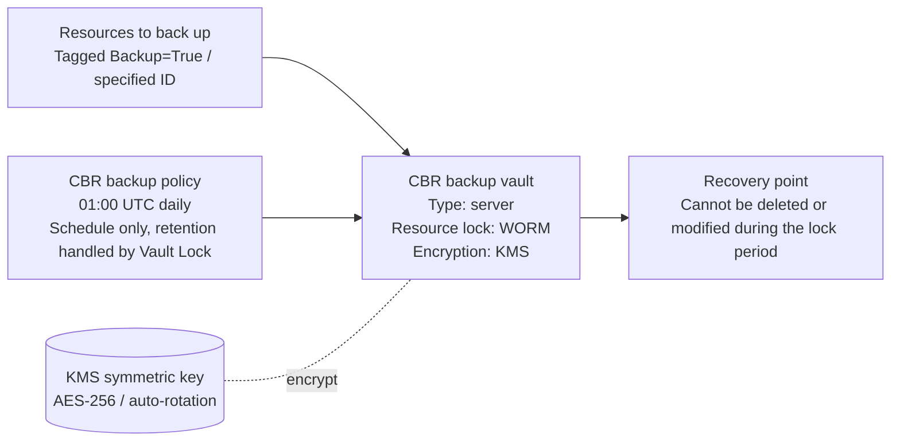

# deterministic-operations-backup-vault-lock


## 1. Overview

### Overview

This practice provides a backup system on Huawei Cloud built on "**resource management by tag + scheduled automatic backup + immutable vault lock (WORM)**". It is suited to scenarios that require tamper protection, accidental-deletion protection, and compliance retention for critical workloads. Everything is declared with Terraform (huaweicloud Provider) and works out of the box.

---

## 2. Table of Contents

- [1. Overview](#1-overview)
- [2. Table of Contents](#2-table-of-contents)
- [3. Architecture Diagram](#3-architecture-diagram)
- [4. Highlights](#4-highlights)
- [5. Cloud Services Used](#5-cloud-services-used)
- [6. Prerequisites](#6-prerequisites)
- [7. Quick Start](#7-quick-start)
- [8. Step-by-Step Deployment](#8-step-by-step-deployment)
- [9. Usage / Verification](#9-usage--verification)
- [10. Cleanup](#10-cleanup)
- [11. Detailed Explanation](#11-detailed-explanation)
- [12. Dependencies](#12-dependencies)
- [13. FAQ / Troubleshooting](#13-faq--troubleshooting)
- [14. Contributing](#14-contributing)
- [15. License](#15-license)
- [16. Contact / Maintainers](#16-contact--maintainers)

---

## 3. Architecture Diagram



---

## 4. Highlights

- **Immutable backup (WORM)**: once resource locking is enabled on the vault, recovery points cannot be deleted or tampered with during the lock period, resisting ransomware and operator errors.
- **Tag-based management**: manage resources flexibly by tag or service resource ID, adapting to dynamic resource scales.
- **Unified scheduling and retention**: a single backup policy centrally defines frequency and retention, simplifying operations.
- **Customer-managed key**: a KMS symmetric key with auto-rotation meets encryption compliance requirements.

---

## 5. Cloud Services Used

| Service | Purpose | Notes |
|---|---|---|
| CBR | Cloud Backup (policy + vault + WORM) | server type by default, with resource locking |
| KMS | Customer key for backup encryption | AES-256, auto-rotation |
| Resource tags | Manage resources to back up by tag | Backup=True |
| Resource ID | Bind resources to back up by ID | backup_resource_ids |

> **Tip**: all services can be created with one click via this repository's Terraform code. To clean up, see [Section 10 "Cleanup"](#10-cleanup).

---

## 6. Prerequisites

- A registered Huawei Cloud account with **Cloud Backup and Recovery (CBR)** and **Key Management Service (KMS)** enabled.
- The account has permissions to create CBR vaults/policies and KMS keys.
- **Terraform >= 1.5.0** installed locally, and able to use **huaweicloud provider 1.96.0** (or a compatible version).
- Target region: `cn-north-4` (change `region` in `infra/variables.tf` if needed).

---

## 7. Quick Start

```bash
# 1. Configure credentials (provided via environment variables)
export HW_ACCESS_KEY="<HW_ACCESS_KEY>"
export HW_SECRET_KEY="<HW_SECRET_KEY>"
export HW_REGION_NAME="cn-north-4"

# 2. Initialize and validate
cd infra
terraform init
terraform validate

# 3. Preview
terraform plan

# 4. Deploy
terraform apply
```

---

## 8. Step-by-Step Deployment

1. **Prepare variables**: `cp infra/terraform.tfvars.example infra/terraform.tfvars`, then modify `vault_size`, `vault_type`, `vault_lock_enabled`, etc. as needed.
2. **Validate**: `terraform validate` should succeed (EXIT=0).
3. **Preview**: `terraform plan` shows that 1 KMS key + 1 CBR policy + 1 CBR vault will be created.
4. **Deploy**: run `terraform apply`.
5. **Manage resources**: see [Usage and Verification](#9-usage--verification).

---

## 9. Usage / Verification

### Usage and Verification

**Manage resources to back up**

- Method A (by ID): fill in `backup_resource_ids` in `terraform.tfvars`, then run `apply` again.
- Method B (by tag): tag resources with `Backup=True`, then bulk-associate them in the CBR console under "Vault → Associated Resources → By Tag" (Terraform does not expose a tag-selection parameter in v1.96.0).

**Verify successful deployment**

- `terraform output` shows `cbr_vault_id`, `cbr_policy_id`, `kms_key_id`, and `cbr_vault_locked=true`.
- In the console, confirm the vault status is `available`, a policy is associated, and the status is "Locked".
- Trigger a backup manually or wait for 01:00 UTC, then confirm a recovery point is produced and cannot be deleted during the lock period.

After deployment, follow these steps to verify that the business functionality works before considering the delivery complete.

---

## 10. Cleanup

```bash
cd infra
terraform destroy
```

> **Important**: with `vault_lock_enabled=true`, the vault is immutable and `terraform destroy` will fail. Before destroying, first **release the vault resource lock** in the CBR console, then run `destroy`.

---

## 11. Detailed Explanation

- Architecture and components: `docs/architecture.md`
- Deployment details and known constraints: `docs/deployment-guide.md`

### Main configuration items (`infra/variables.tf`)

| Variable | Default | Description |
|---|---|---|
| `vault_type` | `server` | Vault type (server/disk), required |
| `vault_size` | `200` | Capacity in GB, explicitly fixed |
| `vault_lock_enabled` | `true` | Whether to enable WORM locking |
| `backup_execution_time` | `01:00` | Daily execution time (UTC) |
| `backup_delete_after_days` | `45` | Recovery point retention count (daily frequency ≈ days) |
| `backup_resource_ids` | `[]` | List of resources bound by ID |

---

## 12. Dependencies

- Huawei Cloud Terraform Provider (`huaweicloud`)
- Huawei Cloud official documentation: Cloud Backup and Recovery (CBR), Key Management Service (KMS)

---

## 13. FAQ / Troubleshooting

- **Q: `terraform destroy` reports that the locked resource cannot be deleted?**
A: The vault has resource locking enabled. Release the lock in the CBR console before destroying.
- **Q: Automatic tag-based resource selection does not work in Terraform?**
A: v1.96.0's CBR resources do not expose tag selection. Use resource ID binding or associate by tag in the console instead.
- **Q: The custom KMS key is not bound to the vault?**
A: The vault uses service-managed encryption by default. Binding a custom CMK must be done in the console.

---

## 14. Contributing

Please submit feedback and improvement suggestions via Issues. This repository does not accept direct PRs; all changes are reviewed and merged by the maintainers.

---

## 15. License

This practice is licensed under **MIT No Attribution**; see the [`LICENSE`](LICENSE) file in the repository root.

---

## 16. Contact / Maintainers
| Item | Content |
|---|---|
| **Creator** | [dgc-git](https://github.com/dgc-git) |
| **Maintainer** | [dgc-git](https://github.com/dgc-git) |
| **Contact** | GitHub Issues / PR (see [Section 14](#14-contributing)) |
