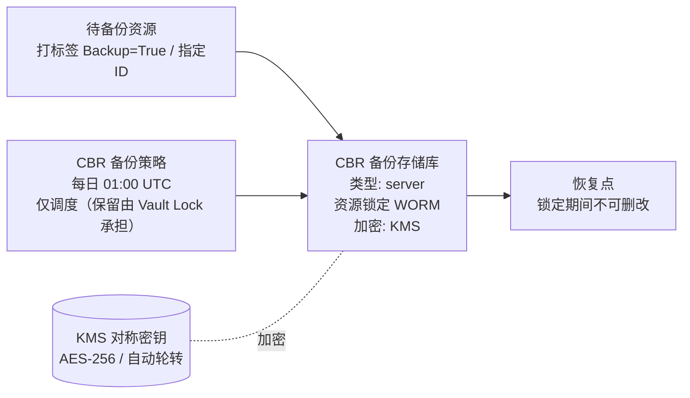

# deterministic-operations-backup-vault-lock · 基于标签的不可变备份实践（华为云 CBR + KMS）


## 1. 简介 / Overview

### 简介


本实践提供一套在华为云上构建「**按标签纳管资源 + 定时自动备份 + 存储库不可变锁定（WORM）**」的备份体系。适用于需要对关键负载做防篡改、防误删、满足合规保留要求的场景。全部以 Terraform（huaweicloud Provider）声明，开箱即用。

---

## 2. 目录

- [1. 简介 / Overview](#1-简介--overview)
- [2. 目录](#2-目录)
- [3. 架构图](#3-架构图)
- [4. 方案亮点](#4-方案亮点)
- [5. 涉及云服务](#5-涉及云服务)
- [6. 前置条件](#6-前置条件)
- [7. 快速开始](#7-快速开始)
- [8. 分步部署](#8-分步部署)
- [9. 使用方法 / 验证](#9-使用方法--验证)
- [10. 清理资源](#10-清理资源)
- [11. 详细说明](#11-详细说明)
- [12. 依赖](#12-依赖)
- [13. FAQ / 故障排除](#13-faq--故障排除)
- [14. 贡献指南](#14-贡献指南)
- [15. 许可证](#15-许可证)
- [16. 联系方式 / 维护者](#16-联系方式--维护者)

---

## 3. 架构图



---

## 4. 方案亮点

- **不可变备份（WORM）**：存储库开启资源锁定后，恢复点锁定期间无法删除/篡改，抵御勒索与误操作。
- **标签化纳管**：按标签或服务资源 ID 灵活纳管，适配动态资源规模。
- **统一调度与保留**：单一备份策略集中定义频率与保留，运维简单。
- **客户管理密钥**：KMS 对称密钥 + 自动轮转，满足加密合规。

---

## 5. 涉及云服务

| 服务 | 用途 | 备注 |
|---|---|---|
| CBR | 云备份（策略 + 存储库 + WORM） | 默认 server 类型，资源锁定 |
| KMS | 备份加密客户密钥 | AES-256，自动轮转 |
| 资源标签 | 按标签纳管待备份资源 | Backup=True |
| 资源 ID | 按 ID 绑定待备份资源 | backup_resource_ids |

> **提示**：所有服务均可通过本仓库的 Terraform 一键创建；如需清理，请参见 [第 10 节「清理资源」](#10-清理资源)。

---

## 6. 前置条件

- 已注册华为云账号，并开通 **云备份 CBR** 与 **密钥管理 KMS**。
- 账号具备创建 CBR 存储库/策略、KMS 密钥的权限。
- 本地安装 **Terraform ≥ 1.5.0**，并可使用 **huaweicloud provider 1.96.0**（或兼容版本）。
- 目标区域：`cn-north-4`（可在 `infra/variables.tf` 修改 `region`）。

---

## 7. 快速开始

```bash
# 1. 配置凭据（通过环境变量提供）
export HW_ACCESS_KEY="<HW_ACCESS_KEY>"
export HW_SECRET_KEY="<HW_SECRET_KEY>"
export HW_REGION_NAME="cn-north-4"

# 2. 初始化并校验
cd infra
terraform init
terraform validate

# 3. 预览
terraform plan

# 4. 部署
terraform apply
```

---

## 8. 分步部署

1. **准备变量**：`cp infra/terraform.tfvars.example infra/terraform.tfvars`，按需修改 `vault_size`、`vault_type`、`vault_lock_enabled` 等。
2. **校验**：`terraform validate` 应返回成功（EXIT=0）。
3. **预览**：`terraform plan` 显示将创建 1 个 KMS 密钥 + 1 个 CBR 策略 + 1 个 CBR 存储库。
4. **部署**：执行 `terraform apply`。
5. **纳管资源**：见[使用方法与验证](#9-使用方法--验证)。

---

## 9. 使用方法 / 验证

### 使用方法与验证


**纳管待备份资源**

- 方式 A（按 ID）：在 `terraform.tfvars` 填入 `backup_resource_ids` 后重新 `apply`。
- 方式 B（按标签）：给资源打 `Backup=True`，在 CBR 控制台「存储库 → 关联资源 → 按标签」批量关联（Terraform 在 v1.96.0 未暴露标签选择参数）。

**验证部署成功**

- `terraform output` 能看到 `cbr_vault_id`、`cbr_policy_id`、`kms_key_id`、`cbr_vault_locked=true`。
- 控制台确认存储库状态 `available`、已关联策略、状态为「已锁定」。
- 手动或等待 01:00 UTC 触发一次备份，确认产生恢复点且锁定期间不可删除。

部署完成后请按本节步骤自行验证，确认业务功能可用，方可视为交付完成。

---

## 10. 清理资源

```bash
cd infra
terraform destroy
```

> ⚠️ **重要**：`vault_lock_enabled=true` 时存储库不可变，`terraform destroy` 会失败。销毁前请先在 CBR 控制台**解除存储库资源锁定**，再执行 `destroy`。

---

## 11. 详细说明

- 架构与组件：`docs/architecture.md`
- 部署细节与已知约束：`docs/deployment-guide.md`

### 主要配置项（`infra/variables.tf`）

| 变量 | 默认 | 说明 |
|---|---|---|
| `vault_type` | `server` | 存储库类型（server/disk），必填 |
| `vault_size` | `200` | 容量 GB，显式写死 |
| `vault_lock_enabled` | `true` | 是否开启 WORM 锁定 |
| `backup_execution_time` | `01:00` | 每日执行时间（UTC） |
| `backup_delete_after_days` | `45` | 保留恢复点数（日频≈天数） |
| `backup_resource_ids` | `[]` | 按 ID 绑定的资源列表 |

---

## 12. 依赖

### 依赖与参考


- 华为云 Terraform Provider（`huaweicloud`）
- 华为云官方文档：云备份 CBR、密钥管理 KMS

---

## 13. FAQ / 故障排除

### FAQ


- **Q：`terraform destroy` 报资源锁定无法删除？**
A：存储库开启了资源锁定，先在 CBR 控制台解除锁定再销毁。
- **Q：按标签自动选择资源在 Terraform 里不生效？**
A：v1.96.0 的 CBR 资源未暴露 tags 选择，请改用资源 ID 绑定或控制台按标签关联。
- **Q：自定义 KMS 密钥没绑定到存储库？**
A：存储库默认服务托管加密；绑定自定义 CMK 在控制台完成。

---

## 14. 贡献指南

请通过 Issue 提交反馈与改进建议；本仓库不接受直接 PR，统一由维护者评审后合入。

---

## 15. 许可证

本实践采用 **MIT No Attribution** 许可证，详见仓库根目录 [`LICENSE`](LICENSE) 文件。

---

## 16. 联系方式 / 维护者
| 项 | 内容 |
|---|---|
| **创建者** | [dgc-git](https://github.com/dgc-git) |
| **维护者** | [dgc-git](https://github.com/dgc-git) |
| **联系方式** | GitHub Issues / PR（见[第 14 节](#14-贡献指南)） |
